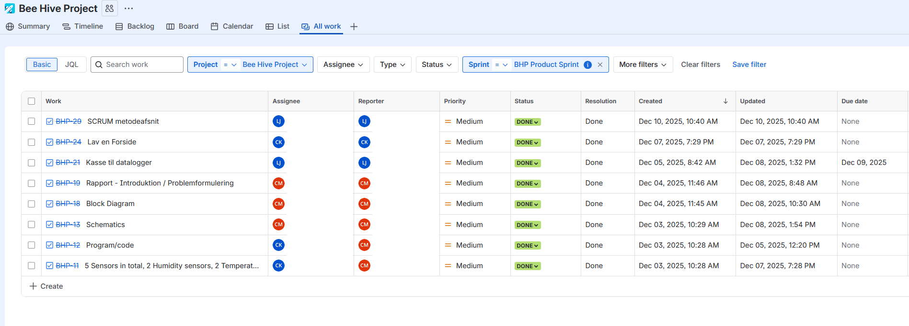

# ReadMe generated with AI.
# Beehive Datalogger

An Arduino-based datalogger that measures temperature, humidity and light inside and outside a (simulated) beehive, and stores the readings on an SD card every 10 minutes.

**Status:** Finished
**Context:** 1st semester exam project, IT-Technology at Zealand (EASJ), December 2025. Courses: Embedded Systems, Programming, Project Management & Business Understanding. Group of 3.

> The report and the code comments are in Danish.

## Why

Beekeepers need to know whether the conditions in a hive are stable and healthy for the bees. Our research question was:

*How can an IoT system be designed to measure the environmental conditions needed for a healthy, stable beehive, and how can the sensor data be used to detect changes that may affect those conditions?*

## Hardware

| Component | Purpose | Arduino pin |
| --- | --- | --- |
| Arduino Mega 2560 | Microcontroller | - |
| DHT22 (inside) | Temperature + humidity inside the hive | D2 |
| DHT22 (outside) | Temperature + humidity outside the hive | D3 |
| Photoresistor (LDR) + 10 kΩ resistor | Light intensity outside | A0 |
| RTC DS3231 + CR2032 battery | Timestamp for every reading (I2C) | SDA 20, SCL 21 |
| Micro SD SPI module + 4 GB card | Stores the data as CSV | CS 53 (SPI) |

The electronics sat in a taped-up cardboard box. To simulate a hive, the box was placed in a wooden crate with a second crate on top as a lid, outdoors in Køge, from 9 to 12 December 2025.

## Code

[`Eksamensprojekt/Eksamensprojekt.ino`](Eksamensprojekt/Eksamensprojekt.ino)

Every 10 minutes the sketch:

1. Reads both DHT22 sensors and the LDR
2. Gets a timestamp from the RTC
3. Skips the reading if a sensor returns an error (`-999`)
4. Writes one line to `DALO.csv` on the SD card and prints it to the Serial Monitor

If the SD card is missing at startup, the program stops on purpose, so it never runs without saving data.

**Libraries:** `dhtnew`, `RTClib`, `SD`, `SPI`, `Wire` (all available in the Arduino Library Manager).

**To run it:** open the `.ino` file in the Arduino IDE, install the libraries, select *Arduino Mega 2560*, and upload. The RTC is set to your computer's time at upload.

## Data

[`DATA.csv`](DATA.csv) is the raw file from the SD card (semicolon-separated). A few things to know when reading it:

- **Temperature and humidity are stored ×10:** `157C` = 15.7 °C, `740%` = 74.0 % humidity.
- **The header line repeats** once an hour, because the code writes a new header every 6th reading.
- **Light is the raw analog value** (0–1023), not lux.
- The first rows from 8 December are indoor test readings.

[`EksamensProjektDALO.xlsx`](EksamensProjektDALO.xlsx) holds the cleaned data, hourly averages and the charts used in the report.

## Results

- **Inside the hive was slightly warmer than outside the whole time**, typically by about 0.5–1 °C. For example, on 10 December the inside ranged from 10.1 to 11.4 °C and the outside from 9.6 to 10.6 °C.
- **Humidity outside was close to 100 %** most of the time (it rained). Humidity inside was lower, but rose during 10 December. We think the towel we put between the crates to keep the rain out absorbed moisture, so we removed it.
- **The light sensor detected daylight from about 8:30 to 15:30.** One spike at 22–23 on 10 December was a flashlight used to check on the logger.

The full analysis is in [`DataAnalyse.docx`](DataAnalyse.docx) and in the report.

## Known issues / what we'd do differently

- **The clock resets when the Arduino restarts.** `rtc.adjust()` in `setup()` sets the time to when the code was compiled, so after a restart the timestamps jump backwards. This is visible in the data. The fix is to set the time once and then remove that line.
- **Units are written into the values** (`157C`, `740%`), which had to be cleaned in Excel. Writing plain numbers would make the data easier to use.
- **The light readings were lower than expected** (max 207 of 1023), probably because of the setup or a faulty LDR.
- **Many sensor errors** were skipped, which gave fewer readings than planned.
- **Ideas for a next version:** Bluetooth (HC-06) or Wi-Fi to download data without opening the hive, a soldered board instead of a breadboard, a 3D-printed case, and more precise sensors (e.g. SHT31 instead of DHT22).

## How we worked

We worked in sprints with SCRUM and a Jira board.

## My role

- Building the protective box and setting up the logger outdoors
- The method section: SCRUM and the technical IoT method
- Data analysis and product analysis
- Conclusion, and the hardware part of "further development"
- Documenting the development process

**Team:** a group of three. My teammates wrote the problem statement, system architecture, schematics and the code; my parts are listed above.

## Report

[Datalogger_rapport.pdf](Datalogger_rapport.pdf) (Danish, 61 pages). Public version: teammates' names, the group contract and the full sprint backlog are removed.
